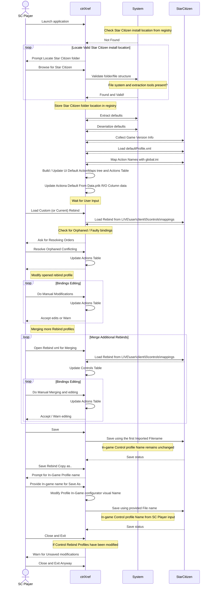
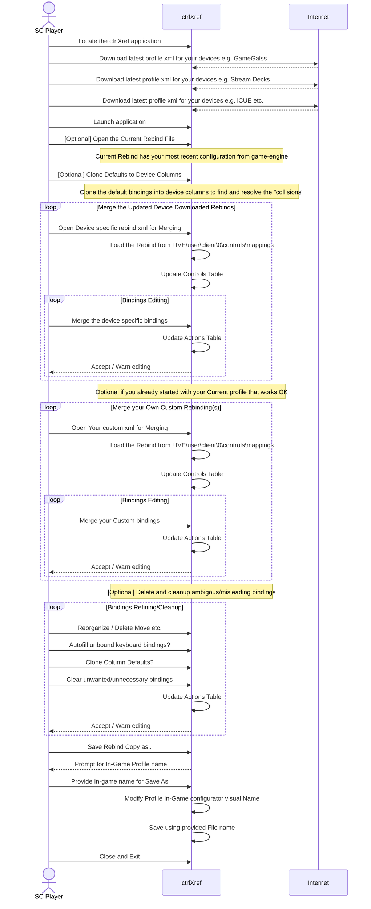
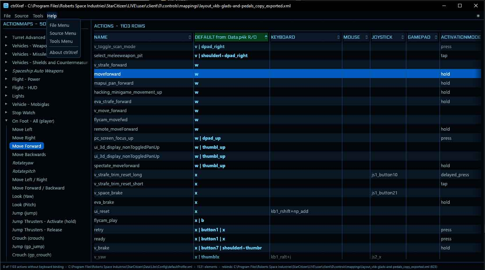
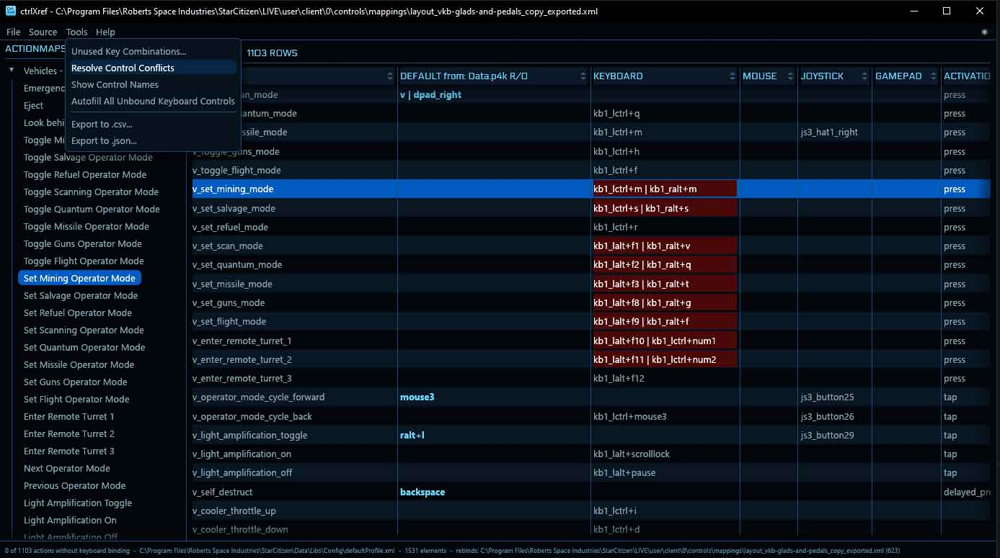
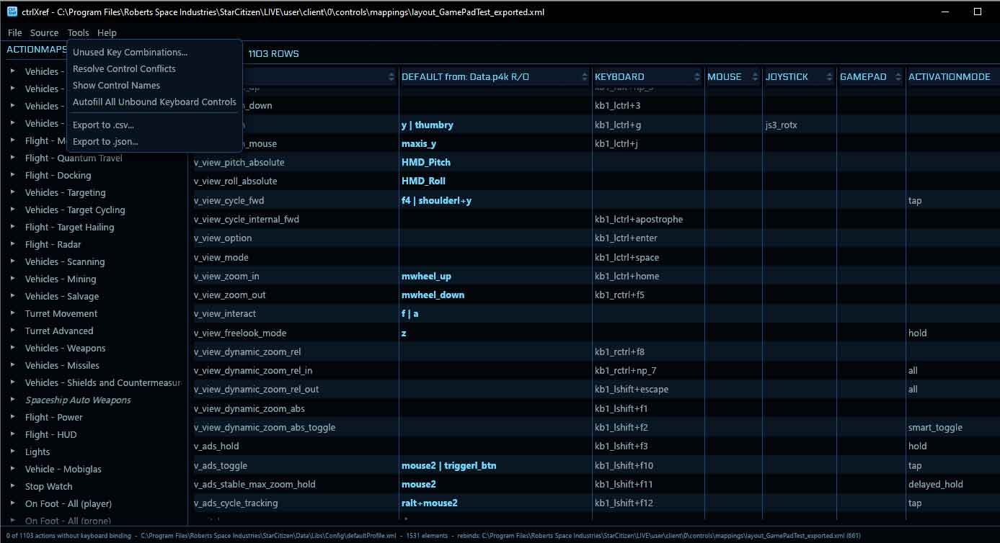
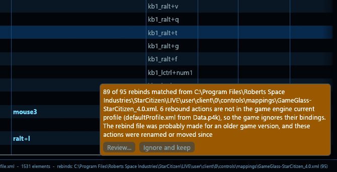
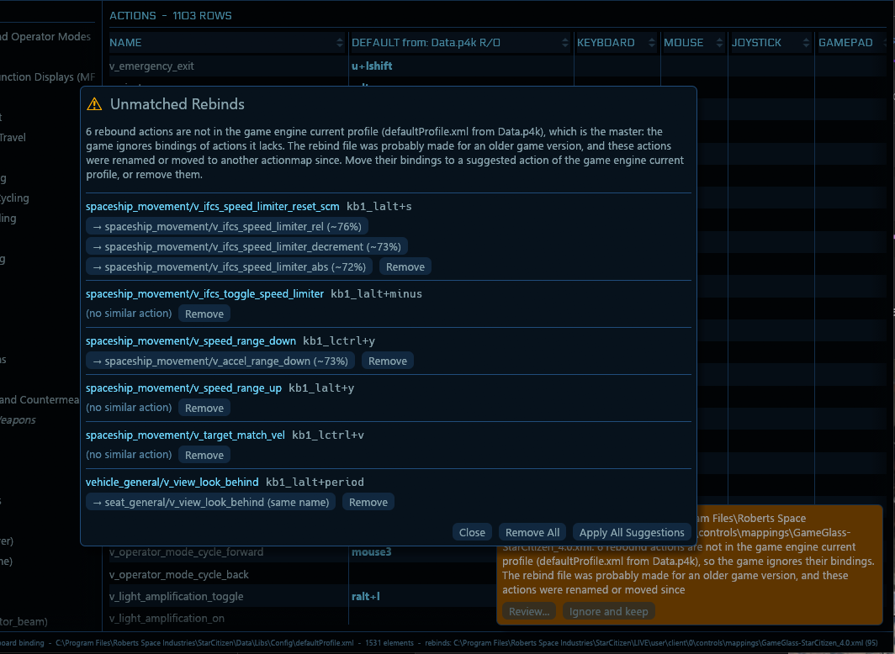
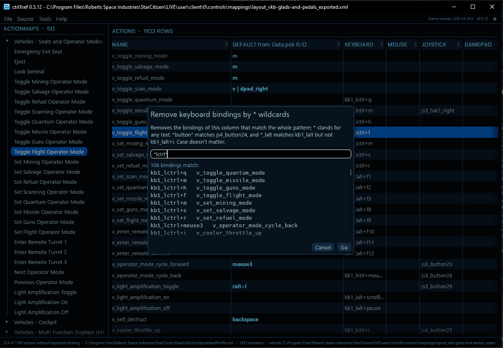
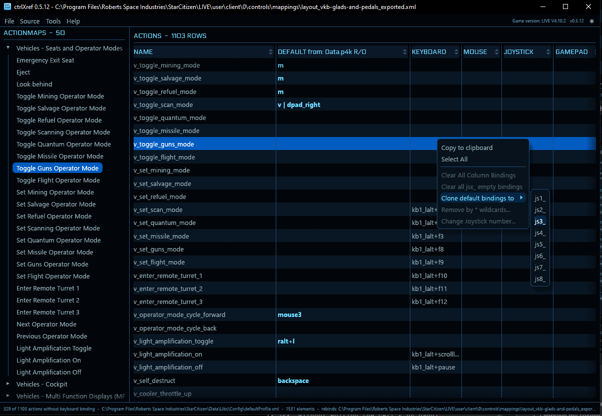
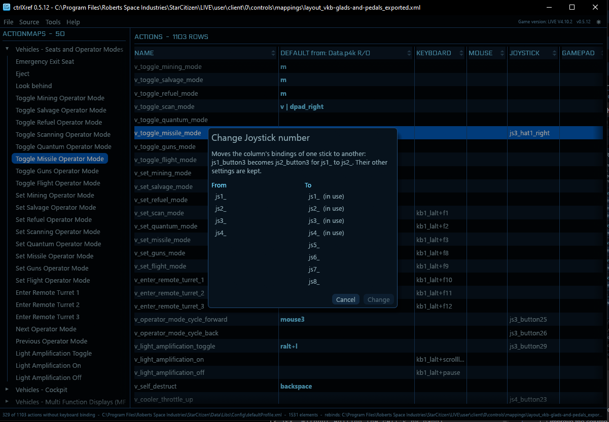

# ctrlXref Star Citizen Control Bindings Cross-reference Utility


A Windows desktop tool for viewing and modifying [Star Citizen](https://robertsspaceindustries.com/) control bindings. ctrlXref cross-references the game's default control profile with your own custom rebind files. You will be able to see and modify every action and its bindings in a single table. Merging multiple custom rebind files from various sources is now supported for creating a new custom binding with all your preferred bindings.
### What it's not


ctrlXref does not identify as a [Star Citizen](https://robertsspaceindustries.com/) control profile editor, as the application lacks proper modeling of the various devices and the controls they provide. You can manipulate the controls manually inside the table cells, but there are only a handful of dialogs, dropdowns and no key or button press etc. capture features. You are hereby encouraged to use the Game's integrated control editor or some other 3rd party solution (such as the great [Star Citizen Profile Editor](https://github.com/Osiris-DevWorks/sc-profile-editor)) to actually create your control settings profiles.  

> [!NOTE]
> ctrlXref is an unofficial fan project and is not affiliated with or endorsed by Cloud Imperium Games.

> [!WARNING]
> Work In Progress! This application is still an early development with testing of the functionality hardly started.
> Make manual backups of your controls under `StarCitizen\LIVE\user\client\0\controls\mappings\` before using ctrlXref 
> as modifications made by this application are ***not reversible*** and might not work properly or at all within the actual game.

## Features

- Does not need to / should not be open when playing Star Citizen as it only manipulates control profile files the actual game uses.
- It reads all the ***\<actionmap>*** and ***\<action>*** elements from `defaultProfile.xml`, and shows them using the game's own English labels.
- See the game-engine default bindings side by side with your rebinds for keyboard, mouse, joystick(s) and gamepad.
- Edit bindings directly in the table, with possible conflicts shown in red.
- Merge multiple custom rebind files to create your preferred control setup and to get a confirmation on which controls are truly bound to what action.
- Conflicting controls manual resolving support (TODO improved edit features sWork In Progress).
- Move or remove bindings of actions that older rebind files name but the game engine's current profile no longer has, with suggested renamed or moved actions.
- List the game's control name list with examples in a sortable table.
- Select cells with a mouse drag or `Ctrl+A` and copy them with `Ctrl+C`, as tab-separated text that pastes into Excel and other tables.
- Search the table and the tree with regular expressions (`Ctrl+F`, `F3`, `Shift+F3`), keeping previous searches in a dropdown list.
- Open the game's current `actionmaps.xml` or any mappings file you exported from the game.
- Create a blank rebind file that "clears" every binding, forcing all default bindings to unbound. ***Behavior inside the game UNTESTED***.
- List unused key combinations and allow their "sequential" assignment of them to actions with no keyboard binding.
- Export the table to a `.csv` file for use in a spreadsheet in the current table sorting order, or to a structured `.json` file that follows the tree.
- Switch between ***dark*** and ***light*** themes (the light theme lacks the game's styling and feel).
- Clone `defaultProfile.xml` bindings into the current rebind setup by column. For the joystick column, choose the jsx_ number to clone to.
- Remove bindings from a column by wildcard `*` matching.
- Change joystick numbers from the context menu. Example: from js2_ to js8_ (numbers 1-8 are available in the game engine, at least in theory; probably at most 5 are really supported currently). NOTE! Swapping two numbers is doable by first moving one to a free number temporarily and then moving the other where the first was... you get the idea, I'm sure.
- The Star Citizen game version and the ctrlXref version are shown in the menu bar, beside the theme selector.
- Notice when the open rebind file is changed by another program, like the game's control editor. With unsaved changes, merge the other program's changes into yours or save yours as a working copy to merge later.


ctrlXref writes only to profile rebind xml files. It never changes `Data.p4k` or `defaultProfile.xml`. Saving the current bindings `actionmaps.xml` spawns a Warning as the file will be overwritten by the game engine on configuration modifications.

## Requirements

- Windows 10 or later 64bit
- A Star Citizen installation (or just a valid Star Citizen Game `Data.p4k` under `StarCitizen\LIVE\` folder)
- The [unp4k tools](#install-the-unp4k-tools), to extract the default controls from the game data
- [Rust](https://www.rust-lang.org/tools/install) (current stable, with the MSVC toolchain), Only needed for building from source.

> [!NOTE]
> ctrlXref works with the **LIVE** version of the game only. It does not handle **PTU** (or other test channel) installations.
> If you want the same controls there, copy your LIVE rebind files from `StarCitizen\LIVE\user\client\0\controls\mappings\`
> to the same folder under `StarCitizen\PTU\` yourself. A PTU build may have new, changed or removed actionmaps and actions;
> handling those is outside the scope of this application.

## Getting started

### Build

```powershell
git clone https://github.com/ai-override/ctrlXref.git
cd ctrlXref
cargo build --release
```

The application is built as `target\release\ctrlxref.exe`.

### Install the unp4k tools

The game's default controls are packed inside `LIVE\Data.p4k`, so ctrlXref uses tools from the [unp4k](https://github.com/dolkensp/unp4k) project to get them out:

| File | Why it is needed |
| --- | --- |
| `unp4k.exe` | Unpacks the selected files from the `Data.p4k` archive. |
| `unforge.cli.exe` | Converts the unpacked XML files from the game's binary CryXML format into plain XML that ctrlXref can read. |
| `x64\libzstd.dll` | Lets unp4k decompress the contents of the archive. |

To install them:

1. Download the Windows package from the [unp4k releases](https://github.com/dolkensp/unp4k/releases) page, for example `unp4k-suite-win-x64-v4.0.87.zip`. ctrlXref has been used with v4.0.87.
2. Copy the **contents** of the zip's `publish` folder directly into your `StarCitizen` installation folder, so that the files end up like this:

```text
StarCitizen\
├── LIVE\
│   └── Data.p4k
├── x64\
│   └── libzstd.dll
├── unp4k.exe
└── unforge.cli.exe
```

ctrlXref looks for the tools only in this location. The default installation folder is `C:\Program Files\Roberts Space Industries\StarCitizen\`. The tools also write into this folder, so your account needs write access to it.

> [!NOTE]
> Older unp4k releases name the converter `unforge.exe`. ctrlXref expects `unforge.cli.exe`, so use a release that includes it.

### Extract the default controls

1. Start `ctrlxref.exe`.
2. Choose **Source > Locate Star Citizen Game Folder...** and select your `StarCitizen` folder. ctrlXref remembers it for the next start.
3. Choose **Source > Extract Defaults from Data.p4k Package**. If the `Data` folder doesn't exist yet, ctrlXref offers to do this at startup.

When extraction finishes, ctrlXref opens the default profile. Extract again after each game patch to pick up the new defaults. The tools' full output is saved to `ctrlxref_extract.log` in the game folder, which helps when an extraction fails.

## Why only part of `Data.p4k` is extracted

ctrlXref extracts only the files needed and creates just those parts of the `Data` folder structure under `StarCitizen`:

```text
StarCitizen\Data\
├── Libs\Config\
│   ├── defaultProfile.xml             Default controls
│   ├── keybinding_localization.xml    Device and key names
│   └── Mappings\
│       └── layout_all_blank.xml       The game's blank control layout
└── Localization\english\
    └── global.ini                     English texts for the action labels
```

This keeps the folder compact and saves a lot of time. A full extraction can take from several minutes to hours in the worst case, depending on your disk and the size of the game. As an example, one 150 GB `Data.p4k` unpacked to almost 1.5 million files taking up about 240 GB.

***BUG***: `unp4k.exe` also unpacks the large game database, `Game2.dcb`, whichever files are requested. ctrlXref deletes it before the conversion step, as the rest of the process doesn't need it.

> [!TIP]
> The conversion step processes everything in the `Data` folder, so it takes longer if the folder already holds a full extraction.

## Usage

Once the game folder is set, ctrlXref opens the extracted default profile at startup. Use **File > Open Current Rebind File** to load your active bindings, or **File > Open Custom Rebind File...** to load an exported mappings file. Edits stay in memory until you save them.

> [!WARNING]
> The game overwrites its current `actionmaps.xml` when you change controls in-game. Use **File > Save Rebind Copy As...** to keep a backup of your bindings. Versions before 0.5.10 gave the copy the original's name in the game's profile list; see the [release notes](https://github.com/ai-override/ctrlXref/releases) to fix older copies.

You can also pass the files to open on the command line:

```text
ctrlxref.exe [profile.xml [rebind.xml]]
```

| Argument | Description |
| --- | --- |
| `profile.xml` | Profile to open, relative to the game folder or as an absolute path. Defaults to `Data\Libs\Config\defaultProfile.xml`. |
| `rebind.xml` | Rebind file to open, relative to the current directory. |

The full documentation is built into the application and is also available in [`docs/help`](docs/help):

- [File menu](docs/help/file.md)
- [Source menu](docs/help/source.md)
- [Tools menu](docs/help/tools.md)
- [Context menus](docs/help/context_menus.md)

## Development

```
cargo run       # Run a debug build
cargo test      # Run the tests
```

`version.txt` holds the application version. `build.rs` raises its patch number on the first build of each day with source changes, so the file regularly shows as modified.

### Basic usage session sequence
This chart describes in detail the actions taken on a normal session. It explains most internal and user actions but does not go into pseudocode level of detail.  


### Update / Merge preferred bindings sequence
Sequence explaining one possible usage sequence in more detail. Here we assume the game version has just updated and some of your device bindings stopped working completely, or they somehow behave different than you'd expect.


## License

ctrlXref is released under the [MIT License](LICENSE). You are free to use, copy, modify, merge, publish, distribute, sublicense and sell copies of the software, as long as the copyright notice and license text are included in all copies or substantial portions of it. The software is provided "as is", without warranty of any kind. See the [`LICENSE`](LICENSE) file for the full terms.

Third-party components keep their own licenses:

- [unp4k](https://github.com/dolkensp/unp4k) is a separate project under the MIT license. It isn't included in this repository.
- The Electrolize font is under the SIL Open Font License. See [`assets/fonts/OFL.txt`](assets/fonts/OFL.txt).


### Donations
If you find this utility useful, consider making a small donation helping me with my huge AI expenses and my extensive high quality Coffee consumption to:
[classloader](https://paypal.me/SCclassloader?target=_blank)

[comment]: # (classloader https://paypal.me/cassoverride?target=_blank Dysfunctional atm because PayPal refuses to accept my business account for receiving payments.) 

[comment]: # (Check the functionality of the paypal.me link as there are constant/random errors in PayPal account settings modifications and many submits and button presses return Try Again Later Errors and Warnings)

[comment]: # (### Discord)

[comment]: # (My Discord: primordialhttps://discord.com/users/primordial_23184?target=_blank)

## Release
For all of us lazy gamers, here's the pre-built exe. No install required or even supported.
[Latest Release](https://github.com/ai-override/ctrlXref/releases)

## Screenshots
- Column sorting 
- Conflict / multibinding resolving 
- Column Autofill (will be refactored into the column context menu soon) 
- Unmatched rebinds warning after opening an older rebind file (a GameGlass layout made for Star Citizen 4.0) 
- Unmatched rebinds resolving with suggested actions of the game engine's current profile 
- Deleting with `*` wildcard(s) 
- Cloning default bindings to a rebind column 
- Changing Joystick numbers 


> ## TODO
> - [ ] Update / improve the integrated Help documentation (ongoing).
> - [ ] Improve the column editing features (maybe quick swap 'kb1_y | kb1_alt+y' <-> 'kb1_alt+y | kb1_y').
> - [x] Add clear column with warning message to the column context menu.
> - [x] Column delete all with wildcards like: kb\* mo1_\* \*x \*maxis\* js2_\* 
> - [ ] Delete: 1 2 3 n  Delete the first, second, third or nth binding from cells with multiple controls (with red warning background, separated by ' | ' Space VerticalBar Space).
> - [x] Joystick number manipulation/changing (swapping joystick jsx_ without editing the cells by hand).  
> - [ ] ***PDF*** File export. Not sure where this would be used?
> - [ ] Printer support (probably doable using the ***Light theme*** quite easily)?
